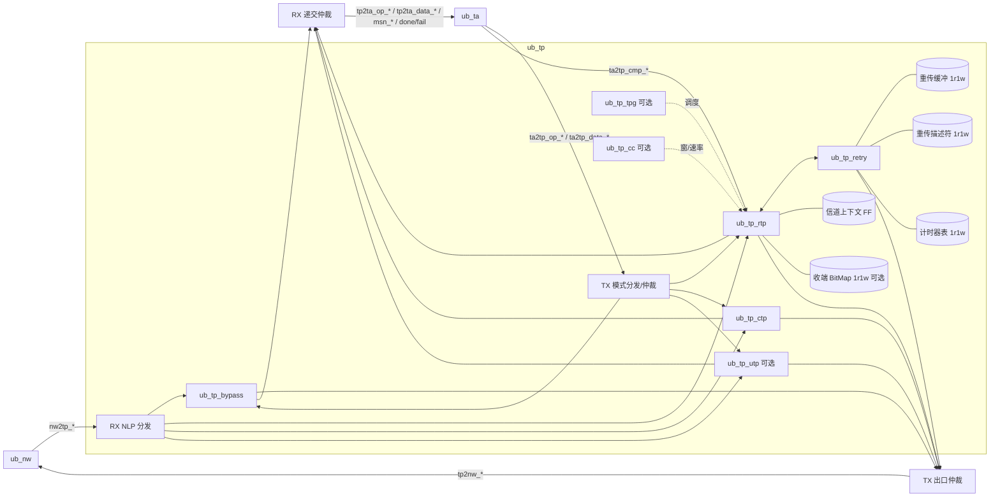

# Vibe-UB 传输层（TP）微架构草案 — B 线

状态：**草案**，供 Xia / 船长评审。基线：repo `lukebest/Vibe-UB` main @ `8c2c498e`（PR #63 计时器措辞；叠在 PR #59 / #18）。
层间口以仓库内 `docs/arch/LAYER_CONTRACTS.md` §2（NW↔TP）、§3（TP↔TA）为权威；本文件只写微架构，不另造口名或口宽。
规范只引用节号（UB Base Spec Rev 2.0 第 6 章，及 §5、§7、附录 B/D 的相关节）。
记号：**【设计-B】** 表示本草案的微架构选择（设计-B 所有）；**【未知】** 表示契约或架构师未锁，本文件不填值；**【Xia】** 表示按 Xia 答复记录采纳；**【定】** 表示船长已定。

---

## 1. 范围与必做功能

### 1.1 分波

| 波次 | 内容 | 依据 |
| --- | --- | --- |
| 第一波（优先通路） | TP bypass：CFG9，无 TPH、无 ICRC；TA↔NW 直通 | §6.1、§6.3；B.2.6；TP-Q01/Q02【Xia】 |
| 第二波（必做） | RTP：单信道 PSN、TPACK/TPNAK、Go-Back-N、超时重传（默认开）、快速重传（CSR 开关）；CFG7 NTH；per-flow；收端乱序接收默认关 | §6.3.1、§6.4.1、§6.4.2.1、§6.4.2.2、§6.7.1；TP-Q01/Q04/Q05【Xia】 |
| 第二波（必做） | CTP：CTPH 1 B，CFG6，服务配置管理报文 | §6.3.2、§6.7.2；TP-Q01【Xia】 |
| 最后一轮（可选） | 选择重传 + TPSACK、乱序接收、UTP、TPG/多径、拥塞控制（CETPH/CAQM） | §6.2.2–§6.2.3、§6.3.3、§6.4.2.3、§6.5、§6.6 |
| 参数开关 | 原子操作相关通路（TA 侧原子在第二波）由 elaboration 参数 `TP_ATOMIC_EN` 控制，默认 0 | TA-Q12/L1/L2【定】 |

### 1.2 必做功能清单

1. bypass：按 `ta2tp_bypass` / `tp2nw_bypass` 透传，保持 sop…eop 连续（§6.3）。
2. RTP 发送：按器件级 MTU 分段（附录 D.1.13；本仓库未锁，标 **未知**，契约 §2）；加 16 B RTPH；分配 PSN（24 bit）与 TPMSN（24 bit）；DstTPN 24 bit（契约 §2）；末包置 last（TPOpcode[7]）；保存副本到重传缓冲（§6.2.1、§6.4.1、§6.7.1.1.1）。
3. RTP 接收：按 DstTPN 查信道上下文；PSN 分三类（按序 / 重复 / 超前）；按序包净荷交 TA；操作收齐时按 TPMSN 顺序通知 TA；按 A 位与合并规则回 TPACK；超前包丢弃并回 TPNAK（§6.4.1、§6.4.2.2.1、§6.7.1.2）。
4. RTP 响应处理：TPACK 累计确认释放重传缓冲；TPNAK 触发 GBN 重发；RSPST/RSPINFO 透传给 TA（§6.4.2、§6.7.1.1.2；TP-Q13【Xia】）。
5. 超时重传：每信道一个 RTO 计时器；最大重传次数可设，超限报 B.2.1（§6.4.2.1；TP-Q11【Xia】）。
6. ROL：末包 TPACK 等目标 TA 完成后发出，并携带 TA 状态（§6.8.2；TP-Q12【Xia】）。
7. 错误：PSN 对且 TPOpcode 异常报 B.2.2；PSN/MSN 不配报 B.2.3；超 MTU 记 C.24（§10.6.2.2.3–4；TP-Q03/Q10【Xia】）。
8. 伪包（F=1）：第一波不发；收到时按普通包做 PSN 检查，丢净荷、计数（TP-Q13【Xia】）。

### 1.3 不做 / 延后

- 建链流程（§6.3.1 称不在规范内）：软件经 CSR 写信道上下文、初始 PSN/EPSN（TP-Q09/Q15【Xia】）。RTL 不带随机数源。
- 每信道 MTU：规范未提供，第一版不做。

---

## 2. 模块划分（与 PR #18 `MODULE_INVENTORY.md` §4 一致，共 8 个）

| 模块 | 一句话用途 | 波次 |
| --- | --- | --- |
| `ub_tp` | TP 顶层：模式分发（RTP/CTP/UTP/bypass）、NW/TA 口仲裁、CSR 与观察口汇总 | 一 |
| `ub_tp_bypass` | 无 TPH 的 TA↔NW 直通，服务 Load/Store 优先通路 | 一 |
| `ub_tp_rtp` | RTP 收发：分段、RTPH 编解码、PSN/EPSN/TPMSN、TPACK/TPNAK 生成与解析、信道上下文 | 二 |
| `ub_tp_ctp` | CTP 收发：1 B CTPH 编解码，无 TPACK | 二 |
| `ub_tp_utp` | UTP 收发：UTPH 编解码，无重传、丢包不上报 | 可选 |
| `ub_tp_retry` | RTP 重传：重传缓冲、描述符表、RTO 计时器、GBN（后加选择重传） | 二 |
| `ub_tp_tpg` | TPG / 多径：成员信道调度 | 可选 |
| `ub_tp_cc` | 拥塞控制：CETPH/CCI、窗/速率/CAQM 状态 | 可选 |

pyCircuit 源：`pycircuit/tp/<leaf>.py`，同层 helper 放 `pycircuit/tp/lib/`（如 RTPH 打包/解包、PSN 比较函数）；生成到 `rtl/tp/`。存储一律例化 `ub_cmn_mem_1r1w`（见 §6）。可选模块在未实现前用桩：输出 `valid=0`、`ready=0`，obs 口置 0。

---

## 3. 框图

TX 出口仲裁优先级【设计-B】：TPACK/TPNAK 响应 > 重传 > 新包 > bypass。理由：响应拖延会引发对端误超时；bypass 走单独 SL/VL 时仍可并行，冲突只在本口。仲裁只在包边界切换。

---

## 4. 数据通路与流水

通则：数据口一律 160 b、1 flit/拍（契约 §2、§3），`core_clk`。LPH.CFG 4 bit：CTP=6、RTP=7、bypass=9（契约 §2）。每级之间用 valid/ready；凡接 `ub_cmn_mem_1r1w` 读口的级，读延迟 1 拍，后面跟 2 项 skid 缓冲以吸收下游 `ready` 回落。

### 4.1 bypass（第一波）

| 级 | 动作 |
| --- | --- |
| B0 | TA flit 寄存一级（打断 TA→NW 组合路径） |
| B1 | 置 `tp2nw_bypass=1`，SL/NLP 由 TA 描述符带入；送 NW |

RX 对称：`nw2tp_*` 中 NLP 指向 TAH 的包直接送 `tp2ta_*`，`nw2tp_err` 映为 `tp2ta_err`（与 eop 同拍）。延迟 1 拍。完成（`tp2ta_done/fail`）由 TA 按对端响应产生，TP 不持状态。

### 4.2 RTP TX（第二波）

| 级 | 动作 | 存储访问 |
| --- | --- | --- |
| T0 | 收 TA 操作描述符（`ta2tp_opcode`、`ta2tp_tassn`、`ta2tp_mode`、`ta2tp_op_len`、`ta2tp_dcna[15:0]`、`ta2tp_bypass`；契约 §3） | — |
| T1 | 读信道上下文（FF）：next_PSN、TPMSN、在途包数、在途字节、对端 CNA/LBF；窗口检查（发送窗见契约 §3 / §6.5.1.4.1）；不过则 `ta2tp_op_ready=0` | CTX 读 |
| T2 | 分配 PSN、算本段长度（min(剩余, MTU)）、生成 RTPH（A 位：末包或每第 8 包置 1）；向重传缓冲申请 flit 槽（空闲链表/环形指针） | — |
| T3 | 头 flit 拼装：RTPH 16 B + TA 头起始字节，后续 flit 移位对齐（RTPH 16 B 不整 20 B，需 4 B 错位寄存） | — |
| T4 | 同拍两路：flit → TX 出口仲裁；flit → RTB 写口；末 flit 写描述符表并启动/续期 RTO | RTB 写、DSC 写、TMR 写 |

吞吐：稳态 1 flit/拍。头 flit 错位带来每包最多 1 拍额外 flit。CTX 更新在 T2 写回，同信道背靠背包通过 T2→T1 前递避免读旧值。

### 4.3 RTP 重传 TX（`ub_tp_retry`）

| 级 | 动作 |
| --- | --- |
| R0 | 触发：TPNAK（PSN=x，GBN 从 x+1 起）、RTO 到期（从最老未确认起）、快速重传开关 |
| R1 | 读描述符表（1 拍） → 得 RTB 起址、flit 数、头字段 |
| R2 | 按 flit 地址顺序读 RTB（每拍 1 读，1 拍延迟），2 项 skid |
| R3 | 送 TX 出口仲裁；RTPH 原样（PSN 不变），重传计数 +1 |

### 4.4 RTP RX（第二波）

| 级 | 动作 | 存储访问 |
| --- | --- | --- |
| X0 | 收 `nw2tp_*` 头 flit，按 NLP 分发；`nw2tp_err`/`nw2tp_icrc_err`/`nw2tp_drop` 的包整包丢 | — |
| X1 | 解 RTPH；DstTPN 低 log2(`NUM_TP_CH`) 位索引上下文，高位比对，失配丢包计数 | CTX 读 |
| X2 | PSN 分类：等于 EPSN → 按序；落在 [EPSN−8M, EPSN−1] → 重复（丢净荷，回 TPACK）；其余 → 超前（乱序关：丢包、回 TPNAK；乱序开：查 BitMap） | BMP 读（可选） |
| X3 | 按序：EPSN+1；TPMSN 检查（B.2.3 规则）；TPOpcode 检查（B.2.2）；长度检查（C.24）；净荷去 RTPH 后交 `tp2ta_data_*` | CTX 写 |
| X4 | 末包且前序齐：`tp2ta_msn_valid/ready` + `tp2ta_tpmsn[23:0]`（契约 §3）；ACK 请求入响应队列（A=1 立即；A=0 合并：8 包或 1 µs；ROL 末包等 `ta2tp_cmp_*` 成交） | — |

TPACK/TPNAK 收向（发送端角色）：X1 后分支到 `ub_tp_retry`，按累计 PSN 释放描述符与 RTB 槽，停/续 RTO。发起端完成仍走 `tp2ta_done` / `tp2ta_fail`（带 `tp2ta_tassn`）。ROL 目标完成走 `ta2tp_cmp_*`；`ta2tp_cmp_rspst` / `ta2tp_cmp_rspinfo` 宽 **未知**（契约 §3）。

### 4.5 CTP

TX：T0→T2（插 1 B CTPH）→出口；RX：X0→X1（解 CTPH）→交 TA。无 PSN、无 TPACK（§6.3.2、§6.7.2）。

---

## 5. 接口（权威：`docs/arch/LAYER_CONTRACTS.md` §2、§3）

下列名与宽一律抄契约。数据口一律 160 b、1 flit/拍。CFG 编码 4 bit：CTP=6、RTP=7、bypass=9。

### 5.1 NW↔TP（契约 §2）

| 组 | 信号 | 握手 |
| --- | --- | --- |
| TX 数据 | `tp2nw_data[159:0]`、`tp2nw_valid/ready/sop/eop` | valid/ready；TP 源；NW 可停 |
| TX 边带 | `tp2nw_sl[3:0]`、`tp2nw_nlp[2:0]`、`tp2nw_bypass`、`tp2nw_dcna[15:0]`、`tp2nw_lbf[7:0]`、`tp2nw_rt[1:0]`、`tp2nw_cci[15:0]` | `valid` 期间保持到成交；NW 写入 NTH |
| RX 数据 | `nw2tp_data[159:0]`、`nw2tp_valid/ready/sop/eop`、`nw2tp_err` | valid/ready；TP 可停（禁止 valid-only）；err 与 eop 同拍 |
| RX 错误 | `nw2tp_icrc_err`（eop 对齐；CFG9 保持 0，CFG7 与 eop 对齐）、`nw2tp_drop`（1 拍） | — |
| 控制/状态 | `nw2tp_flush`（电平）、`nw_link_up`（电平） | `nw_link_up=0` ⇒ 无 TX 成交 |

RX 侧是否另开 `nw2tp_scna` / `nw2tp_cci`、以及 `nw2tp_data` 是否已剥 NTH：契约标 **未知**（Q-1）。24-b CNA 格式下 `tp2nw_dcna` 是否加宽：**未知**。

### 5.2 TP↔TA（契约 §3）

| 组 | 信号 | 握手 |
| --- | --- | --- |
| 提交描述符 | `ta2tp_op_valid/ready`、`ta2tp_opcode[7:0]`、`ta2tp_tassn[15:0]`、`ta2tp_mode[1:0]`、`ta2tp_bypass`、`ta2tp_dcna[15:0]`、`ta2tp_op_len` | valid/ready，每拍 ≤1 个操作。`ta2tp_mode` 编码 **未知**；`ta2tp_op_len` 宽 **未知**（Q-8） |
| 提交净荷 | `ta2tp_data[159:0]`、`ta2tp_valid/ready/sop/eop` | valid/ready |
| 完成 | `tp2ta_done`、`tp2ta_fail`（互斥，1 拍，带 `tp2ta_tassn`）、`tp2ta_err`（最后净荷 eop 对齐） | 脉冲。`tp2ta_fail` 原因码 **未知**（Q-9） |
| 整操作完成 | `tp2ta_msn_valid/ready`、`tp2ta_tpmsn[23:0]` | valid/ready；成交键为 TPMSN |
| 收向递交 | `tp2ta_op_*`、`tp2ta_data_*`（含 `tp2ta_tassn[15:0]`、`tp2ta_tpmsn[23:0]`） | valid/ready |
| ROL 目标完成 | `ta2tp_cmp_valid/ready`、`ta2tp_cmp_tassn[15:0]`、`ta2tp_cmp_fail`、`ta2tp_cmp_opcode[7:0]`、`ta2tp_cmp_rspst`、`ta2tp_cmp_rspinfo`；可选 `ta2tp_cmp_data[159:0]` / valid/ready/sop/eop | valid/ready；成交后再发该操作末包 TPACK。`rspst` / `rspinfo` 宽 **未知** |

提交口 `ready=0` 的原因：发送窗满（§6.5.1.4.1）或下游 `tp2nw_ready=0`（契约 §3）。ROL 等待走 `ta2tp_cmp_*`，不堵提交口。`ta2tp_op_ch` 是否每操作给出：**未知**。

### 5.3 flush / link-down

`nw2tp_flush=1` / `nw_link_up=0`：不得开始新包（契约 §2）。每个未决 TASSN 须 `done` 或 `fail`；每个未决 TPMSN 经 `tp2ta_msn_*` 成交（契约 §3）。flush 拍数 **未知**。flush 后未确认操作一律 `fail` 还是等 link 恢复后续传：**未知**（Q-10）。信道上下文是否保留由软件决定，本文件不另定。

---

## 6. 状态与表（映射到 `ub_cmn_mem_1r1w`）

原语时序（CODING_STYLE §10）：1R1W；寄存读 1 拍；同址同拍读返回旧值；阵列无复位；可选 `WMASK_W`。设计约束由此而来：
- 阵列无复位 ⇒ 每表配一组 FF 的 valid 位（`tb_<inst>_bd_vld_*` 挂在这里），复位只清 valid。
- 读旧值 ⇒ 同址写后紧跟读的路径须前递（RMW 型表）。
- 单读口 ⇒ 同一表的多个读者须仲裁，下表写明读者。

| 表 | 所属 | 实例 | DEPTH | WIDTH | 理由 |
| --- | --- | --- | --- | --- | --- |
| 重传缓冲 RTB | `ub_tp_retry` | `ub_cmn_mem_1r1w` | 4096 | 160 | 全局 64 KB 净荷份额【Xia TP-Q06】按 flit 计 = 3277，取 2 的幂 4096（80 KB 原始容量，含 RTPH/头开销与碎片余量）；宽度等于 1 flit，读写各 1 flit/拍正好匹配线速。参数 `TP_RTB_DEPTH` |
| 重传描述符 DSC | `ub_tp_retry` | `ub_cmn_mem_1r1w` | 512 | 96 | `NUM_TP_CH`16 × 窗 32 包 = 512【设计-B】；字段：RTB 起址 12 + flit 数 9 + PSN 24 + TPMSN 24 + TASSN 16 + opcode/last/A 10 + 保留 1 = 96。按「信道号 × 32 + PSN 低 5 位」寻址，无需 CAM。器件级 MTU **未知**，flit 数字段宽不据此回填 |
| RTO/计时器表 TMR | `ub_tp_retry` | `ub_cmn_mem_1r1w` | 16 | 32 | 每信道：µs 计数 23 + 重传次数 3 + 档位/使能 4 + ACK 合并计数 2（合并 8 包计数另放 CTX）。由 1 µs 节拍驱动的轮询扫描器逐项读改写，16 项在 80 拍/µs 内扫完 |
| 收端 BitMap BMP（可选） | `ub_tp_rtp` | `ub_cmn_mem_1r1w` + `WMASK_W` | 16 | 128 | 乱序接收开启时才例化（`TP_OOO_EN`）；宽度 = 乱序区间下限 128【Xia TP-Q05】，区间 ≤ BitMap 宽度；按位 WMASK 置位，滑窗时整字重写 |
| 信道上下文 CTX | `ub_tp_rtp` | FF【设计-B】 | 16 | ≈ 220 | 字段见下；每包两次访问（T1 读、T2/X3 写）且背靠背同址，1 拍寄存读加前递代价高于 16×220 FF；`NUM_TP_CH>32` 时改例化 1r1w（Q-4） |

CTX 每信道字段（TX/RX 各一套 PSN 空间）：valid 1、DstTPN 高位 20、对端 CNA 16（契约 §2 优先通路 `dcna[15:0]`；24-b 格式口宽 **未知**）、LBF 8、TX next_PSN 24、TX 最老未确认 PSN 24、TX TPMSN 24、在途包 6、在途字节 17、RX EPSN 24、RX TPMSN 24、RX 当前 TPMSN 首 PSN 24、ACK 合并计数 3、快速重传/乱序/算法选择 4。

RTB 空间管理：每信道静态切片（4096/16 = 256 flit ≈ 5 KB/信道）【设计-B】。比空闲链表简单，代价是单信道最多 ~1 个 4096 B 包在途。若需单信道大窗，改为全局环形 + 每信道字节份额（Q-5）。

读口仲裁：RTB 读者只有重传引擎；DSC 读者为 ACK 处理（释放）与重传引擎，ACK 优先；TMR 读者只有扫描器，ACK/重传对计时器的更新走写口并在扫描器读到同址时前递。

PSN 规则（§6.4.1【Xia】）：24 bit，next = (cur+1) mod 2^24；最大已发 − 最小待确认 ≤ 2^23−1（窗上限 256 自动满足）；重复区间 [EPSN−2^23, EPSN−1]；响应包不占 PSN；比较用模 2^24 有符号差，helper 放 `pycircuit/tp/lib/psn.py`。

---

## 7. 计时器参数

1 µs 节拍：小数累加分频。`F_CORE = 80.566 MHz`（SPEC §3：2.578125 Gb/s / 32），累加步长 Q16：每拍加 2^16，阈值 `round(80.566 × 2^16)` = 5 279 973，超过即出 1 µs 脉冲并减阈值。误差 < 1 ppm。

| 参数 | 默认 | 单位 | 公式 / 来源 | 归属 |
| --- | --- | --- | --- | --- |
| `TP_RTO_MODE` | 静态 | — | 静态四档 / 动态，CSR 选（§6.4.2.1 示例；TP-Q11【Xia】） | `ub_tp_retry` |
| `TP_RTO_BASE_US` | 8 | µs | 动态 Base_time（TP-Q11） | 同 |
| `TP_RTO_CNT_W` | 23 | bit | 覆盖 4 s 档 | 同 |
| `TP_RETX_MAX` | 7 | 次 | 超限报 B.2.1 | 同 |
| `TP_ACK_COAL_PKTS` / `_US` | 8 / 1 | 包 / µs | TP-Q12 | `ub_tp_rtp` |
| `RETRY_WAIT_CYC` | 323 | `core_clk` 拍 | ceil(4 µs × 80.566 MHz) = ceil(322.264) = 323【定】 | **DLL**（`ub_dll_retry`，UB-DL §4.7.3.3） |
| `PROBE_WAIT_CYC` | 323 | `core_clk` 拍 | 同上公式【定】 | **PHY LMSM**（`ub_lmsm`，UB-PHY §3.4.3.2） |

说明：RETRY WAIT 与 Probe.Wait 分属第 4 章与第 3 章，TP 不消费（M-5【Xia】；契约 §3 同文）。本表列出它们只为把船长定的 4 µs / 323 拍公式落在同一处，实现放各自模块的参数表。通用公式：`X_CYC = ceil(T_us × F_CORE_MHz)`，改频率时随 `F_CORE` 重新计算，TB 可用 `*_TMR_SCALE` 缩短。

---

## 8. 时钟与复位

- 单时钟 `core_clk` ≈ 80.57 MHz；TP 内无 CDC（CODING_STYLE §2）。
- 业务寄存器 `pyc_reg` 同步复位，接 `rst_pyc`。
- `ub_cmn_mem_1r1w` 阵列无复位；复位只清各表 valid FF 与指针。复位后首拍所有 `valid=0`，`ready` 视能收与否。
- 复位后 CTX 全无效，RTP 信道须软件写入后才可用；bypass 复位后即可用。
- Entity 复位：清对应 Entity 的未决操作（对 TA 打 fail），不影响下层链路（§10.6.1，契约 §3）。

---

## 9. 与 `LAYER_CONTRACTS` §2 / §3 的对照（main `968747fb` / #59）

权威在契约。本表每条指向契约；本文件不另造口。

| 编号 | 契约位置 | 契约现状 | 本草案 |
| --- | --- | --- | --- |
| M-1 | §2 TX 边带 | `tp2nw_sl[3:0]`、`tp2nw_nlp[2:0]`、`tp2nw_bypass`、`tp2nw_dcna[15:0]`、`tp2nw_lbf[7:0]`、`tp2nw_rt[1:0]`、`tp2nw_cci[15:0]` | **关闭**（契约已锁边带；RX `scna`/`cci` 另开与否仍 **未知**，见 Q-1） |
| M-2 | §3 整操作完成 | `tp2ta_msn_valid/ready` + `tp2ta_tpmsn[23:0]` | **关闭** |
| M-3 | §3 ROL 目标完成 | `ta2tp_cmp_valid/ready`、`ta2tp_cmp_tassn[15:0]`、`ta2tp_cmp_fail`、`ta2tp_cmp_opcode[7:0]` | **关闭**，但 `ta2tp_cmp_rspst` / `ta2tp_cmp_rspinfo` 宽仍 **未知** |
| M-4 | §2 / §3 字段 | RTPH 16 B；DstTPN / PSN / TPMSN 各 24 b | 上述已锁。器件级 MTU 仍 **未知**（附录 D.1.13，契约未锁） |
| M-5 | §3 反压 / 计时器 | `RETRY_WAIT_CYC` / `PROBE_WAIT_CYC`（323 拍超时）分别归属 DLL（§4.7.3.3）与 LMSM（§3.4.3.2）；TP 使用本层 RTO 与 ACK 合并（§6.4.2.1） | **关闭**【Xia】。与契约 §3 一致 |
| M-6 | §2 未决 | GBN 与选择重传两套都有；先做哪一套 **未知** | 仍 **未知**。实现上 GBN 先做，SR 另跟踪（清单回填不在本 PR） |
| M-7 | §2 ICRC | ICRC 适用于 CFG7；CFG9（bypass）不带 | **关闭** |
| M-8 | §3 握手 | 提交口 `ready=0`：发送窗满（§6.5.1.4.1）或 `tp2nw_ready=0`；ROL 走 `ta2tp_cmp_*` | **关闭** |
| M-9 | §2 / §3 发送窗 | 发送窗见 §6.5.1.4.1；拥塞控制属 `ub_tp_cc` | **关闭** |

---

## 10. 开放问题

架构师未锁的标 **未知**，本文件不填值。其余为设计-B 微架构决定，沿用本草案已写选择。

### 10.1 仍 **未知**（待架构师）

1. **Q-1** RX：`nw2tp_data` 是否已剥 NTH；是否另开 `nw2tp_scna` / `nw2tp_cci`（契约 §2 未决）。TX 边带已由契约锁定（M-1）。
2. **Q-2** 与 `tp2ta_msn_*` / `ta2tp_cmp_*` 相关的拍序、TPMSN 回 TA 的拍位、描述符是否带信道号 / DstTPN：契约标 **未知**。口名与已锁宽见 M-2 / M-3。
8. **Q-8** `ta2tp_op_len` 宽度（及 TA 最大操作长度）：**未知**（契约 §3）。
9. **Q-9** `tp2ta_fail` 原因码集合与编码：**未知**（契约 §3）。
10. **Q-10** flush 后未确认操作一律 `fail`，还是等 link 恢复后续传：**未知**（契约 §3）。拍数亦 **未知**。

### 10.2 设计-B 决定（沿用本草案已写选择）

3. **Q-3** TX 出口仲裁：响应 > 重传 > 新包 > bypass。只在包边界切换。
4. **Q-4** 信道上下文用 FF（16 信道）；`NUM_TP_CH>32` 时改 1r1w。
5. **Q-5** RTB 每信道静态切片（256 flit）。
6. **Q-6** RTB `DEPTH=4096`、宽 160 b（比 64 KB 净荷份额多 16 KB 头/碎片余量）。
7. **Q-7** 描述符按「信道 × 32 + PSN 低 5 位」直接寻址；单信道窗参数化为 32。
11. **Q-11** 1 µs 节拍由 TP 自建 Q16 分频（§7），不依赖尚未存在的共享 tick。
12. **Q-12** 关闭（M-5【Xia】）：`RETRY_WAIT` / `PROBE_WAIT`（323 拍）属 DLL（§4.7.3.3）/ LMSM（§3.4.3.2）；TP 自用 RTO 与 ACK 合并（§6.4.2.1）。
13. **Q-13** `TP_ATOMIC_EN` 默认 0；本层只影响长度检查与 TPMSN 计数，不另开通路。
14. **Q-14** 收到 F=1：按普通包做 PSN 检查，丢净荷、计数；按 A 位回 TPACK。obs 计数口名不在本草案另起。
15. **Q-15** HOOKS：DSC 进 SPEC §10 点名存储（`tb_<inst>_bd_*`）；RTB 不进。

---

## 11. Unknown items（wave-1 `ub_tp_bypass` RTL）

契约标 **未知** 的口不出现在本叶 RTL。登记如下（只写节号 / 口名，不填值）：

| 项 | 契约 | 本叶 |
| --- | --- | --- |
| `ta2tp_op_len` | §3；宽 **未知**（Q-8） | 不作为 RTL 口 |
| `ta2tp_mode` 编码 | §3；四模式编码 **未知** | 不作为 RTL 口 |
| `ta2tp_cmp_rspst` / `ta2tp_cmp_rspinfo` | §3；宽 **未知**（M-3） | 不作为 RTL 口（ROL 属第二波） |
| 24 b DCNA 口 | §2；优先通路锁 16 b；24 b 格式口宽 **未知** | 不作为 RTL 口；只用 `ta2tp_dcna[15:0]` / `tp2nw_dcna[15:0]` |
| NTH.NLP→TAH 码点 | §2 **未知**（PR #61） | `tp2nw_nlp` 本叶置 0；不发明码点 |
| `tp2nw_sl` / `lbf` / `rt` / `cci` 的 TA 侧来源 | 契约只锁 TP→NW 边带宽 | 本叶置 0；来源标 **未知** |
| `nw2tp_icrc_err` | CFG9 无 ICRC（M-7 / B.2.6） | 不作为 RTL 口 |
| `nw2tp_drop` / `tp2ta_done` / `tp2ta_fail` / `tp2ta_msn_*` / `ta2tp_cmp_*` / `ta2tp_opcode` / `ta2tp_tassn` | 宽已锁者留给父级或第二波 | 本叶不引出（无状态完成 / 无 TPH） |

与 §10.1 的 Q-1 / Q-2 / Q-8 / Q-9 / Q-10 一并视为已登记未知，本叶不填值。

---

## 附：设计-B 选择汇总

- D1 TX 仲裁优先级（§3）。D2 口名与宽跟契约 §2 / §3，不再自拟。D3 CTX 用 FF。D4 RTB 静态切片、DEPTH 4096。D5 DSC 直接寻址。D6 µs 分频 Q16 阈值。D7 RX 头 flit 错位处理 1 拍。
