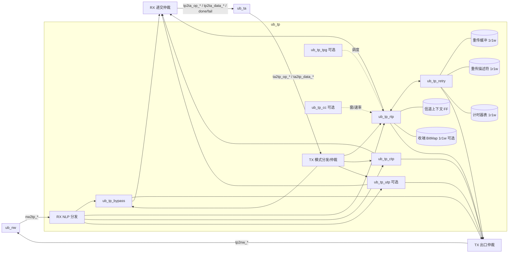

# Vibe-UB 传输层（TP）微架构草案 — B 线

状态：**草案**，供 Xia / 船长评审。基线：repo `lukebest/Vibe-UB` main @ `124b1504`（PR #18）。
规范只引用节号（UB Base Spec Rev 2.0 第 6 章，及 §5、§7、附录 B/D 的相关节）。
记号：**【假设】** 表示本草案自定的值或做法，待确认；**【Xia】** 表示按 Xia 答复记录采纳；**【定】** 表示船长已定。

---

## 1. 范围与必做功能

### 1.1 分波

| 波次 | 内容 | 依据 |
| --- | --- | --- |
| 第一波（优先通路） | TP bypass：CFG9，无 TPH、无 ICRC；TA↔NW 直通 | §6.1、§6.3；B.2.6；TP-Q01/Q02【Xia】 |
| 第二波（必做） | RTP：单信道 PSN、TPACK/TPNAK、Go-Back-N、超时重传（默认开）、快速重传（CSR 开关）；CFG7 NTH；per-flow；收端乱序接收默认关 | §6.3.1、§6.4.1、§6.4.2.1、§6.4.2.2、§6.7.1；TP-Q01/Q04/Q05【Xia】 |
| 第二波（必做） | CTP：CTPH 1 B，CFG6，服务配置管理报文 | §6.3.2、§6.7.2；TP-Q01【Xia】 |
| 最后一轮（可选） | 选择重传 + TPSACK、乱序接收、UTP、TPG/多径、拥塞控制（CETPH/CAQM） | §6.2.2–§6.2.3、§6.3.3、§6.4.2.3、§6.5、§6.6 |
| 参数开关 | 原子操作相关通路（TA 侧原子在第二波）由 elaboration 参数 `TP_ATOMIC_EN` 控制，默认 0 | TA-Q12/L1/L2【定】 |

### 1.2 必做功能清单

1. bypass：按 `ta2tp_bypass` / `tp2nw_bypass` 透传，保持 sop…eop 连续（§6.3）。
2. RTP 发送：按器件级 MTU（1024/4096，8192 参数可选；附录 D.1.13）分段；加 16 B RTPH；分配 PSN（24 bit，模 16M）与 TPMSN（24 bit）；末包置 last（TPOpcode[7]）；保存副本到重传缓冲（§6.2.1、§6.4.1、§6.7.1.1.1）。
3. RTP 接收：按 DstTPN 查信道上下文；PSN 分三类（按序 / 重复 / 超前）；按序包净荷交 TA；操作收齐时按 TPMSN 顺序通知 TA；按 A 位与合并规则回 TPACK；超前包丢弃并回 TPNAK（§6.4.1、§6.4.2.2.1、§6.7.1.2）。
4. RTP 响应处理：TPACK 累计确认释放重传缓冲；TPNAK 触发 GBN 重发；RSPST/RSPINFO 透传给 TA（§6.4.2、§6.7.1.1.2；TP-Q13【Xia】）。
5. 超时重传：每信道一个 RTO 计时器；最大重传次数可设，超限报 B.2.1（§6.4.2.1；TP-Q11【Xia】）。
6. ROL：末包 TPACK 等目标 TA 完成后发出，并携带 TA 状态（§6.8.2；TP-Q12【Xia】）。
7. 错误：PSN 对且 TPOpcode 异常报 B.2.2；PSN/MSN 不配报 B.2.3；超 MTU 记 C.24（§10.6.2.2.3–4；TP-Q03/Q10【Xia】）。
8. 伪包（F=1）：第一波不发；收到时按普通包做 PSN 检查，丢净荷、计数（TP-Q13【Xia】）。

### 1.3 不做 / 延后

- 建链流程（§6.3.1 称不在规范内）：软件经 CSR 写信道上下文、初始 PSN/EPSN（TP-Q09/Q15【Xia】）。RTL 不带随机数源。
- 每信道 MTU：规范未提供，第一版不做。

---

## 2. 模块划分（与 PR #18 `MODULE_INVENTORY.md` §4 一致，共 8 个）

| 模块 | 一句话用途 | 波次 |
| --- | --- | --- |
| `ub_tp` | TP 顶层：模式分发（RTP/CTP/UTP/bypass）、NW/TA 口仲裁、CSR 与观察口汇总 | 一 |
| `ub_tp_bypass` | 无 TPH 的 TA↔NW 直通，服务 Load/Store 优先通路 | 一 |
| `ub_tp_rtp` | RTP 收发：分段、RTPH 编解码、PSN/EPSN/TPMSN、TPACK/TPNAK 生成与解析、信道上下文 | 二 |
| `ub_tp_ctp` | CTP 收发：1 B CTPH 编解码，无 TPACK | 二 |
| `ub_tp_utp` | UTP 收发：UTPH 编解码，无重传、丢包不上报 | 可选 |
| `ub_tp_retry` | RTP 重传：重传缓冲、描述符表、RTO 计时器、GBN（后加选择重传） | 二 |
| `ub_tp_tpg` | TPG / 多径：成员信道调度 | 可选 |
| `ub_tp_cc` | 拥塞控制：CETPH/CCI、窗/速率/CAQM 状态 | 可选 |

pyCircuit 源：`pycircuit/tp/<leaf>.py`，同层 helper 放 `pycircuit/tp/lib/`（如 RTPH 打包/解包、PSN 比较函数）；生成到 `rtl/tp/`。存储一律例化 `ub_cmn_mem_1r1w`（见 §6）。可选模块在未实现前用桩：输出 `valid=0`、`ready=0`，obs 口置 0。

---

## 3. 框图

TX 出口仲裁优先级【假设】：TPACK/TPNAK 响应 > 重传 > 新包 > bypass。理由：响应拖延会引发对端误超时；bypass 走单独 SL/VL 时仍可并行，冲突只在本口。若船长要求 bypass 绝对优先（优先通路规则），把 bypass 提到首位，代价是 RTP 响应延迟受 LS 流量影响（Q-7）。仲裁只在包边界切换。

---

## 4. 数据通路与流水

通则：1 flit = 160 b（20 B），1 flit/拍，`core_clk`。每级之间用 valid/ready；凡接 `ub_cmn_mem_1r1w` 读口的级，读延迟 1 拍，后面跟 2 项 skid 缓冲以吸收下游 `ready` 回落。

### 4.1 bypass（第一波）

| 级 | 动作 |
| --- | --- |
| B0 | TA flit 寄存一级（打断 TA→NW 组合路径） |
| B1 | 置 `tp2nw_bypass=1`，SL/NLP 由 TA 描述符带入；送 NW |

RX 对称：`nw2tp_*` 中 NLP 指向 TAH 的包直接送 `tp2ta_*`，`nw2tp_err` 映为 `tp2ta_err`（与 eop 同拍）。延迟 1 拍。完成（`tp2ta_done/fail`）由 TA 按对端响应产生，TP 不持状态。

### 4.2 RTP TX（第二波）

| 级 | 动作 | 存储访问 |
| --- | --- | --- |
| T0 | 收 TA 操作描述符（opcode、tassn、mode、长度、信道号） | — |
| T1 | 读信道上下文（FF）：next_PSN、TPMSN、在途包数、在途字节、对端 CNA/LBF；窗口检查（包数 ≤ `TP_WIN_PKTS`，字节 ≤ 该信道份额）；不过则 `ta2tp_op_ready=0` | CTX 读 |
| T2 | 分配 PSN、算本段长度（min(剩余, MTU)）、生成 RTPH（A 位：末包或每第 8 包置 1）；向重传缓冲申请 flit 槽（空闲链表/环形指针） | — |
| T3 | 头 flit 拼装：RTPH 16 B + TA 头起始字节，后续 flit 移位对齐（RTPH 16 B 不整 20 B，需 4 B 错位寄存） | — |
| T4 | 同拍两路：flit → TX 出口仲裁；flit → RTB 写口；末 flit 写描述符表并启动/续期 RTO | RTB 写、DSC 写、TMR 写 |

吞吐：稳态 1 flit/拍。头 flit 错位带来每包最多 1 拍额外 flit。CTX 更新在 T2 写回，同信道背靠背包通过 T2→T1 前递避免读旧值。

### 4.3 RTP 重传 TX（`ub_tp_retry`）

| 级 | 动作 |
| --- | --- |
| R0 | 触发：TPNAK（PSN=x，GBN 从 x+1 起）、RTO 到期（从最老未确认起）、快速重传开关 |
| R1 | 读描述符表（1 拍） → 得 RTB 起址、flit 数、头字段 |
| R2 | 按 flit 地址顺序读 RTB（每拍 1 读，1 拍延迟），2 项 skid |
| R3 | 送 TX 出口仲裁；RTPH 原样（PSN 不变），重传计数 +1 |

### 4.4 RTP RX（第二波）

| 级 | 动作 | 存储访问 |
| --- | --- | --- |
| X0 | 收 `nw2tp_*` 头 flit，按 NLP 分发；`nw2tp_err`/`nw2tp_icrc_err`/`nw2tp_drop` 的包整包丢 | — |
| X1 | 解 RTPH；DstTPN 低 log2(`NUM_TP_CH`) 位索引上下文，高位比对，失配丢包计数 | CTX 读 |
| X2 | PSN 分类：等于 EPSN → 按序；落在 [EPSN−8M, EPSN−1] → 重复（丢净荷，回 TPACK）；其余 → 超前（乱序关：丢包、回 TPNAK；乱序开：查 BitMap） | BMP 读（可选） |
| X3 | 按序：EPSN+1；TPMSN 检查（B.2.3 规则）；TPOpcode 检查（B.2.2）；长度检查（C.24）；净荷去 RTPH 后交 `tp2ta_data_*` | CTX 写 |
| X4 | 末包且前序齐：发「操作收齐」通知（按 TPMSN 序）；ACK 请求入响应队列（A=1 立即；A=0 合并：8 包或 1 µs；ROL 末包等 TA 完成） | — |

TPACK/TPNAK 收向（发送端角色）：X1 后分支到 `ub_tp_retry`，按累计 PSN 释放描述符与 RTB 槽，停/续 RTO；RSPST/RSPINFO 经 `tp2ta_done/fail` 边带透传。

### 4.5 CTP

TX：T0→T2（插 1 B CTPH）→出口；RX：X0→X1（解 CTPH）→交 TA。无 PSN、无 TPACK（§6.3.2、§6.7.2）。

---

## 5. 接口（按 `docs/arch/LAYER_CONTRACTS.md` §2、§3）

### 5.1 NW↔TP

| 组 | 信号 | 握手 |
| --- | --- | --- |
| TX 数据 | `tp2nw_data[159:0]`、`tp2nw_valid/ready/sop/eop` | valid/ready；TP 源；NW 可停 |
| TX 边带 | `tp2nw_sl[3:0]`、`tp2nw_nlp[2:0]`、`tp2nw_bypass` | 随 sop 有效，保持到 eop 成交 |
| RX 数据 | `nw2tp_data[159:0]`、`nw2tp_valid/ready/sop/eop`、`nw2tp_err` | valid/ready；TP 可停（禁止 valid-only）；err 与 eop 同拍 |
| RX 错误 | `nw2tp_icrc_err`（eop 对齐）、`nw2tp_drop`（1 拍） | — |
| 控制/状态 | `nw2tp_flush`（电平）、`nw_link_up`（电平） | `nw_link_up=0` ⇒ TP 不发起新包 |

RTP 需要的 NTH 字段（DCNA、LBF、CCI、RT）在契约口上没有：见 §9 不一致项 M-1。【假设】补 `tp2nw_dcna[23:0]`、`tp2nw_lbf[7:0]`、`tp2nw_rt[1:0]`（随 sop），以及 RX 侧 `nw2tp_scna[23:0]`。

### 5.2 TP↔TA

| 组 | 信号 | 握手 |
| --- | --- | --- |
| 提交描述符 | `ta2tp_op_valid/ready`、`ta2tp_opcode[7:0]`、`ta2tp_tassn[15:0]`、`ta2tp_mode[1:0]`、`ta2tp_bypass` | valid/ready，每拍 ≤1 个操作 |
| 提交净荷 | `ta2tp_data[159:0]`、`ta2tp_valid/ready/sop/eop` | valid/ready |
| 完成 | `tp2ta_done`、`tp2ta_fail`（互斥，1 拍，带 `tp2ta_tassn`）、`tp2ta_err`（eop 对齐） | 脉冲，TA 必须当拍收 |
| 收向递交 | `tp2ta_op_*`、`tp2ta_data_*` | valid/ready |

【假设】补充信号（见 M-2/M-3）：
- `tp2ta_op_cmpl_valid/ready` + `tp2ta_op_cmpl_tpmsn[23:0]`：收端「操作收齐」通知（§6.1、§6.7.1.2.1）。
- `ta2tp_tgt_done_valid/ready` + 状态（RSPST 3 b、RSPINFO 5 b）+ 信道号 + TPMSN：ROL 下目标 TA 完成后通知 TP 发末包 TPACK（§6.8.2）。
- `ta2tp_op_ch[log2(NUM_TP_CH)-1:0]`、`ta2tp_op_len`（字节，宽待定）：RTP 选信道与分段所需。
- `tp2ta_fail_rsn[2:0]`：区分超时超限（B.2.1）、TPNAK 不可恢复、flush。

### 5.3 flush / link-down

`nw2tp_flush=1` 期间：不开新包；RTB 内未确认的操作对 TA 逐个 `fail`（rsn=flush），描述符清空，RTO 停；信道上下文保留（软件决定是否复位信道）。flush 完成所需拍数上界 = 未决操作数（≤ `TP_DSC_DEPTH`）+ 常数，记入 SPEC 回填。

---

## 6. 状态与表（映射到 `ub_cmn_mem_1r1w`）

原语时序（CODING_STYLE §10）：1R1W；寄存读 1 拍；同址同拍读返回旧值；阵列无复位；可选 `WMASK_W`。设计约束由此而来：
- 阵列无复位 ⇒ 每表配一组 FF 的 valid 位（`tb_<inst>_bd_vld_*` 挂在这里），复位只清 valid。
- 读旧值 ⇒ 同址写后紧跟读的路径须前递（RMW 型表）。
- 单读口 ⇒ 同一表的多个读者须仲裁，下表写明读者。

| 表 | 所属 | 实例 | DEPTH | WIDTH | 理由 |
| --- | --- | --- | --- | --- | --- |
| 重传缓冲 RTB | `ub_tp_retry` | `ub_cmn_mem_1r1w` | 4096 | 160 | 全局 64 KB 净荷份额【Xia TP-Q06】按 flit 计 = 3277，取 2 的幂 4096（80 KB 原始容量，含 RTPH/头开销与碎片余量）；宽度等于 1 flit，读写各 1 flit/拍正好匹配线速。参数 `TP_RTB_DEPTH` |
| 重传描述符 DSC | `ub_tp_retry` | `ub_cmn_mem_1r1w` | 512 | 96 | `NUM_TP_CH`16 × 窗 32 包 = 512；字段：RTB 起址 12 + flit 数 8（≤ 8192 B/20 B + 1 = 411 需 9，取 9）+ PSN 24 + TPMSN 24 + TASSN 16 + opcode/last/A 10 + 保留 1 = 96。按「信道号 × 32 + PSN 低 5 位」寻址，无需 CAM |
| RTO/计时器表 TMR | `ub_tp_retry` | `ub_cmn_mem_1r1w` | 16 | 32 | 每信道：µs 计数 23 + 重传次数 3 + 档位/使能 4 + ACK 合并计数 2（合并 8 包计数另放 CTX）。由 1 µs 节拍驱动的轮询扫描器逐项读改写，16 项在 80 拍/µs 内扫完 |
| 收端 BitMap BMP（可选） | `ub_tp_rtp` | `ub_cmn_mem_1r1w` + `WMASK_W` | 16 | 128 | 乱序接收开启时才例化（`TP_OOO_EN`）；宽度 = 乱序区间下限 128【Xia TP-Q05】，区间 ≤ BitMap 宽度；按位 WMASK 置位，滑窗时整字重写 |
| 信道上下文 CTX | `ub_tp_rtp` | FF【假设】 | 16 | ≈ 220 | 字段见下；每包两次访问（T1 读、T2/X3 写）且背靠背同址，1 拍寄存读加前递代价高于 16×220 FF；`NUM_TP_CH>32` 时改例化 1r1w（Q-4） |

CTX 每信道字段（TX/RX 各一套 PSN 空间）：valid 1、DstTPN 高位 20、对端 CNA 24、LBF 8、TX next_PSN 24、TX 最老未确认 PSN 24、TX TPMSN 24、在途包 6、在途字节 17、RX EPSN 24、RX TPMSN 24、RX 当前 TPMSN 首 PSN 24、ACK 合并计数 3、快速重传/乱序/算法选择 4。

RTB 空间管理：每信道静态切片（4096/16 = 256 flit ≈ 5 KB/信道）【假设】。比空闲链表简单，代价是单信道最多 ~1 个 4096 B 包在途。若需单信道大窗，改为全局环形 + 每信道字节份额（Q-5）。

读口仲裁：RTB 读者只有重传引擎；DSC 读者为 ACK 处理（释放）与重传引擎，ACK 优先；TMR 读者只有扫描器，ACK/重传对计时器的更新走写口并在扫描器读到同址时前递。

PSN 规则（§6.4.1【Xia】）：24 bit，next = (cur+1) mod 2^24；最大已发 − 最小待确认 ≤ 2^23−1（窗上限 256 自动满足）；重复区间 [EPSN−2^23, EPSN−1]；响应包不占 PSN；比较用模 2^24 有符号差，helper 放 `pycircuit/tp/lib/psn.py`。

---

## 7. 计时器参数

1 µs 节拍：小数累加分频。`F_CORE = 80.566 MHz`（SPEC §3：2.578125 Gb/s / 32），累加步长 Q16：每拍加 2^16，阈值 `round(80.566 × 2^16)` = 5 279 973，超过即出 1 µs 脉冲并减阈值。误差 < 1 ppm。

| 参数 | 默认 | 单位 | 公式 / 来源 | 归属 |
| --- | --- | --- | --- | --- |
| `TP_RTO_MODE` | 静态 | — | 静态四档 / 动态，CSR 选（§6.4.2.1 示例；TP-Q11【Xia】） | `ub_tp_retry` |
| `TP_RTO_BASE_US` | 8 | µs | 动态 Base_time（TP-Q11） | 同 |
| `TP_RTO_CNT_W` | 23 | bit | 覆盖 4 s 档 | 同 |
| `TP_RETX_MAX` | 7 | 次 | 超限报 B.2.1 | 同 |
| `TP_ACK_COAL_PKTS` / `_US` | 8 / 1 | 包 / µs | TP-Q12 | `ub_tp_rtp` |
| `RETRY_WAIT_CYC` | 323 | `core_clk` 拍 | ceil(4 µs × 80.566 MHz) = ceil(322.264) = 323【定】 | **DLL**（`ub_dll_retry`，UB-DL §4.7.3.3） |
| `PROBE_WAIT_CYC` | 323 | `core_clk` 拍 | 同上公式【定】 | **PHY LMSM**（`ub_lmsm`，UB-PHY §3.4.3.2） |

说明：RETRY WAIT 与 Probe.Wait 两个超时在规范中分属第 4 章与第 3 章，TP 不消费。本表列出它们只为把船长定的 4 µs 公式落在同一处，实现放各自模块的参数表；见 M-5。通用公式：`X_CYC = ceil(T_us × F_CORE_MHz)`，改频率时随 `F_CORE` 重新计算，TB 可用 `*_TMR_SCALE` 缩短。

---

## 8. 时钟与复位

- 单时钟 `core_clk` ≈ 80.57 MHz；TP 内无 CDC（CODING_STYLE §2）。
- 业务寄存器 `pyc_reg` 同步复位，接 `rst_pyc`。
- `ub_cmn_mem_1r1w` 阵列无复位；复位只清各表 valid FF 与指针。复位后首拍所有 `valid=0`，`ready` 视能收与否。
- 复位后 CTX 全无效，RTP 信道须软件写入后才可用；bypass 复位后即可用。
- Entity 复位：清对应 Entity 的未决操作（对 TA 打 fail），不影响下层链路（§10.6.1，契约 §3）。

---

## 9. 与 PR #18 契约 / 清单的不一致（对照第 6 章）

| 编号 | 位置 | 现状 | 第 6 章 / 已有答复 | 建议 |
| --- | --- | --- | --- | --- |
| M-1 | LAYER_CONTRACTS §2 口表 | TP→NW 只有 SL/NLP/bypass 边带 | RTP 走 CFG7，需 DCNA、LBF（区分信道，§6.5.1.2）、RT（§5.3.2）；CC 要读写 CCI（§6.6） | 补 `tp2nw_dcna/lbf/rt/cci` 与 RX `nw2tp_scna/cci`，或明确 NTH 由 TP 生成放 data |
| M-2 | LAYER_CONTRACTS §3 | 收向只有 `tp2ta_op_*` + data | §6.1、§6.7.1.2.1：净荷逐包交 TA，另有「操作收齐」按 TPMSN 通知 | 补操作收齐通知口 |
| M-3 | LAYER_CONTRACTS §3 | 无目标 TA→TP 完成口 | §6.8.2：ROL 末包 TPACK 等目标 TA 完成，携带 TA 状态 | 补 `ta2tp_tgt_done_*` |
| M-4 | LAYER_CONTRACTS §2/§3 字段表 | PSN 空间、RTPH 位宽、TP MTU 写「未知」 | §6.2.1、§6.4.1 已给（PSN 24、RTPH 16 B 各字段）；MTU 在附录 D.1.13 | 按 Xia 答复 §0.3/§0.4 回填 |
| M-5 | 任务决策 | RETRY WAIT / Probe 超时列为 TP 参数 | 第 6 章无这两个计时器；TP 计时器为 RTO、ACK 合并、（TA 侧）RNR | 参数归 DLL/LMSM，TP 只放 RTO 系列 |
| M-6 | MODULE_INVENTORY §4 | `ub_tp_rtp`「可后加」，`ub_tp_retry`「RTP 必做」，GBN/SR「未知」 | §6.4.2 超时重传默认开；TP-Q01 定 GBN 先做 | 清单回填 GBN 先做、SR 可选 |
| M-7 | LAYER_CONTRACTS §2 错误表 | ICRC 是否每包都带「未知」 | CFG9 无 ICRC（B.2.6）；CFG7 带 ICRC（§5.3.7） | 回填：bypass 无，RTP 有 |
| M-8 | LAYER_CONTRACTS §3 握手 | 「禁止 valid-only」理由写 ROL 等完成 | §6.8.2 的等待发生在目标 TP 发 TPACK 时，与 TA→TP 提交口握手方式无关 | 理由改为窗满 / 下游反压 |
| M-9 | LAYER_CONTRACTS §3 反压 | RTP 窗满引 §6.6.1.1（拥塞窗） | 发送窗限制见 §6.5.1.4.1；拥塞窗在 CC 可选模块 | 引用改为 §6.5.1.4.1 + TP-Q06 |

---

## 10. 给 Xia 的开放问题

1. NW↔TP 口上 NTH 字段（DCNA/LBF/RT/CCI）由 TP 以边带交给 NW，还是 TP 直接在 data 里写好 NTH？RX 侧 NW 交给 TP 的 data 是否已剥 NTH？（M-1）
2. 契约 §3 是否接受新增「操作收齐」口与 ROL 目标完成口（M-2/M-3）？信号名请定。
3. TX 出口仲裁：bypass 是否必须绝对优先于 RTP 响应 / 重传？
4. 信道上下文用 FF（16 信道 ≈ 3.5 Kbit）可否接受？`NUM_TP_CH` 上限多少时改用 1r1w？
5. RTB 空间：每信道静态切片（256 flit）还是全局环形 + 字节份额？前者单信道吞吐受限。
6. RTB 64 KB 全局份额按净荷计还是按含头 flit 计？本草案取 DEPTH 4096×160 b，比 64 KB 多 16 KB。
7. 描述符表按「信道 × 32 + PSN 低 5 位」直接寻址，是否同意把单信道窗固定为 2 的幂（32）并以参数改？
8. `ta2tp_op_len` 宽度：按 TA 最大操作长度定，请给上限（TA-Q05 关联）。
9. `tp2ta_fail` 原因码集合与编码（契约中「原因 未知」）。
10. flush 时 RTB 中未确认操作一律 fail，还是等 link 恢复后续传？
11. 计时器 1 µs 节拍由 TP 自建分频，还是全芯片共享一个 `ub_cmn_us_tick`（DLL/LMSM/TA RNR 也要）？
12. RETRY_WAIT_CYC / PROBE_WAIT_CYC 归 DLL / LMSM 参数表，确认 TP 不持有（M-5）。
13. `TP_ATOMIC_EN` 的作用面：TP 层只影响长度检查与 TPMSN 计数，还是另有路径？默认 0 是否同意？
14. 收到 F=1 伪包时是否回 TPACK（按 A 位）——TP-Q13 已采纳，请确认 obs 计数口名。
15. HOOKS：RTB / DSC 是否进 SPEC §10 点名存储（给 `tb_<inst>_bd_*` backdoor）？建议 DSC 进、RTB 不进。

---

## 附：假设汇总

- A1 TX 仲裁优先级（§3）。A2 新增接口信号（§5）。A3 CTX 用 FF。A4 RTB 静态切片、DEPTH 4096。A5 DSC 直接寻址。A6 µs 分频 Q16 阈值。A7 RX 头 flit 错位处理 1 拍。上述均待评审。
